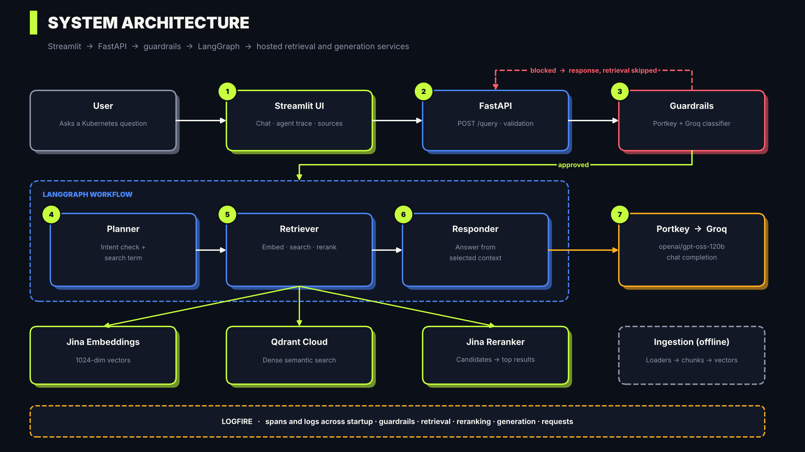
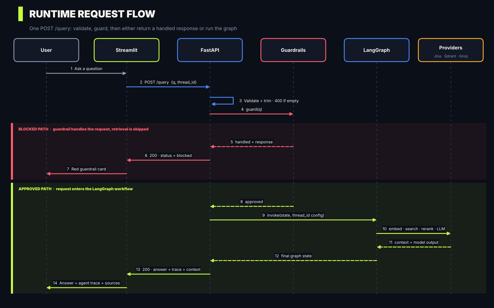
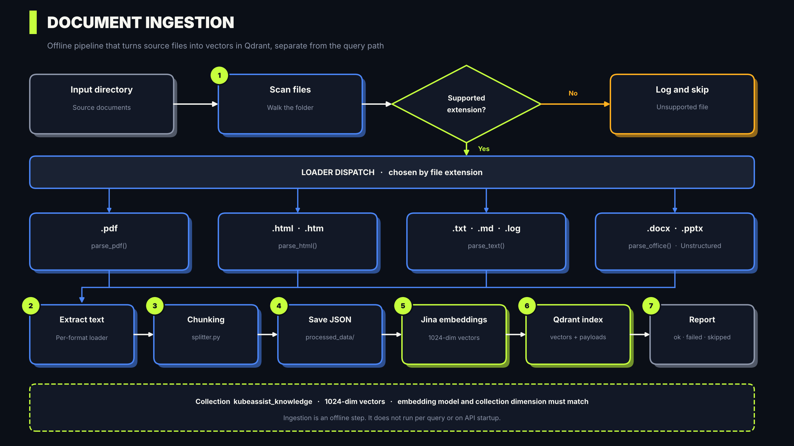
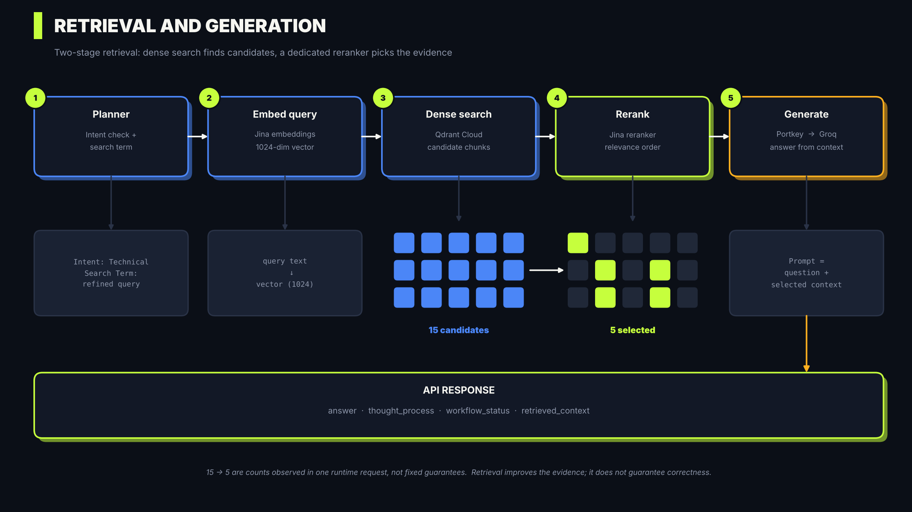
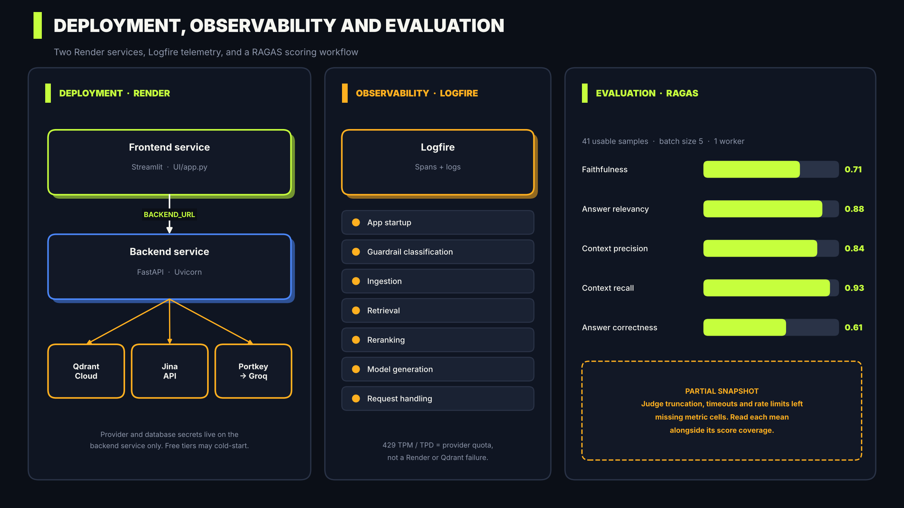

<div align="center">

# ☸️ KubeAssist

### Agentic RAG assistant for Kubernetes documentation and operational knowledge

Ask a Kubernetes question and get an answer grounded in a curated document knowledge base, with the full agent trace and the retrieved evidence one click away.


[Architecture](#system-architecture) · [Quick start](#quick-start) · [API](#api-reference) · [Evaluation](#evaluation) · [Roadmap](#limitations-and-roadmap)

</div>

<!-- Add a screenshot of the UI here once you have one:
 -->

---

## Contents

- [Overview](#overview)
- [Highlights](#highlights)
- [System Architecture](#system-architecture)
- [Runtime Request Flow](#runtime-request-flow)
- [Document Ingestion](#document-ingestion)
- [Retrieval and Generation](#retrieval-and-generation)
- [Deployment and Evaluation](#deployment-and-evaluation)
- [Design decisions](#design-decisions)
- [Tech stack](#tech-stack)
- [Quick start](#quick-start)
- [Configuration](#configuration)
- [API reference](#api-reference)
- [Evaluation](#evaluation)
- [Deploying to Render](#deploying-to-render)
- [Observability and troubleshooting](#observability-and-troubleshooting)
- [Security considerations](#security-considerations)
- [Limitations and roadmap](#limitations-and-roadmap)
- [Repository structure](#repository-structure)
- [Contributing](#contributing) · [License](#license)

---

## Overview

KubeAssist is an **Agentic Retrieval-Augmented Generation (RAG)** application that answers Kubernetes questions from a curated document knowledge base. It combines a Streamlit frontend, a FastAPI backend, LangGraph orchestration, Jina embeddings and reranking, Qdrant Cloud vector search, a Portkey gateway routed to Groq, and Logfire observability.

A question enters through a **guardrail gate** before any retrieval happens. Approved questions run through a LangGraph workflow that plans the query, retrieves candidate chunks, reranks them, and generates a grounded answer. The API returns the answer together with the execution trace and the retrieved context, so the UI can show *how* an answer was produced and *what evidence* it used.

All model and embedding workloads are hosted, so no local LLM or GPU is required.

> **Scope.** KubeAssist is a documentation and operational-knowledge assistant. The reviewed API and UI do not connect to a Kubernetes cluster, execute `kubectl`, or expose live cluster metrics. It should not be described as an autonomous cluster operator or a live monitoring dashboard.

---

## Highlights

| | |
|---|---|
| **Guardrails first** | Every request is classified before it can reach retrieval. Handled requests return a clear `blocked` response and skip the RAG pipeline entirely. |
| **Two-stage retrieval** | Dense semantic search in Qdrant finds candidates, then a dedicated Jina reranker selects the evidence for generation. |
| **Transparent answers** | The response carries the agent trace and retrieved chunks, and the UI renders both under every answer. |
| **Agentic workflow** | A LangGraph planner → retriever → responder graph, with a conversation `thread_id` passed into the checkpoint config. |
| **Observable** | Logfire spans and logs cover startup, guardrails, ingestion, retrieval, reranking, generation and request handling. |
| **Measured** | A RAGAS evaluation workflow scores faithfulness, relevancy, context precision and recall, and answer correctness. |
| **Deployable** | Separate frontend and backend services on Render, with provider secrets kept on the backend only. |

---

## System Architecture



| Layer | Component | Responsibility |
|---|---|---|
| UI | Streamlit | Chat, history, agent trace, retrieved-context display |
| API | FastAPI | Validation, guardrail invocation, graph execution, response serialization |
| Orchestration | LangGraph | Coordinates the agent workflow and thread configuration |
| Planning | Planner node | Interprets the question and prepares the retrieval-oriented query |
| Retrieval | Retriever node | Coordinates embeddings, vector search and reranking |
| Embeddings | Jina | Converts document chunks and queries into vectors |
| Vector store | Qdrant Cloud | Stores vectors and payloads, performs semantic search |
| Reranking | Jina Reranker | Reorders candidates by relevance to the query |
| Generation | Responder node | Generates the answer from the question and selected context |
| Gateway | Portkey | Routes chat-completion calls to the configured provider integration |
| Model provider | Groq | Hosts the configured LLM |
| Guardrails | Python rules + classifier | Handles requests that should not enter normal RAG |
| Observability | Logfire | Application logs and spans |
| Evaluation | RAGAS | Scores answer and retrieval quality |

---

## Runtime Request Flow



1. **Frontend request.** Streamlit keeps a session-scoped UUID and sends `{"q": "...", "thread_id": "..."}` to `POST /query`.
2. **Validation.** A Pydantic `QueryRequest` enforces `q` (1–10,000 chars) and `thread_id` (1–256 chars). The endpoint trims both and rejects empty values with HTTP 400.
3. **Guardrail gate.** `guard(q)` runs before the graph. Runtime logs showed classifier categories `TECHNICAL`, `OFF_TOPIC`, `JAILBREAK` and `UNCERTAIN`. A handled request returns immediately with `status: "blocked"`, a trace showing retrieval was skipped, and empty context.
4. **Graph invocation.** The initial state carries `messages`, `current_query`, `documents`, `plan` and `status`. The graph runs with `config={"configurable": {"thread_id": thread_id}}`.
5. **Planning, retrieval, generation.** The planner prepares the query, the retriever embeds, searches and reranks, and the responder generates the answer through Portkey → Groq.
6. **Response.** The API returns `answer`, `thought_process`, `status`, `workflow_status`, `retrieved_context` and `sources`.

**Outcomes**

| Condition | Behavior |
|---|---|
| Guardrail handles the request | HTTP 200, `status: "blocked"`, retrieval skipped |
| Graph completes | HTTP 200, `status: "completed"` |
| Invalid request | Pydantic validation error or HTTP 400 |
| Unexpected backend failure | Exception logged, generic HTTP 500 returned |
| `/graph` PNG generation fails | HTTP 500 |

A guardrail-handled request is a handled application response, not an HTTP error. The observed guardrail runtime used a Portkey + Groq classifier, and runtime logs stated that NeMo semantic input flows were disabled. Keeping Colang configuration files in the repo does not mean those flows are active.

---

## Document Ingestion



Ingestion is a separate, offline workflow. It does not run per query or on API startup. It scans a folder, picks a loader by extension, extracts text, chunks it, saves processed JSON, embeds the chunks with Jina, and indexes vectors and payloads into Qdrant.

| Extension | Loader |
|---|---|
| `.pdf` | `parse_pdf()` |
| `.html`, `.htm` | `parse_html()` |
| `.txt`, `.md`, `.log` | `parse_text()` |
| `.docx`, `.pptx` | `parse_office()` (Unstructured) |

The observed collection name is `kubeassist_knowledge` with 1024-dimension vectors. The embedding model and the collection dimension must stay compatible. Spreadsheet (`.xlsx`) ingestion is **not** supported by the current dispatch.

---

## Retrieval and Generation



Retrieval is split into two stages so each can do what it is best at:

1. **Candidate retrieval.** The query is embedded with Jina and Qdrant returns the most semantically similar chunks (dense search).
2. **Reranking.** A dedicated Jina reranker reorders those candidates against the query and keeps the best ones.
3. **Generation.** The responder sends the question and the selected context through the shared Portkey client to the configured Groq model.

One observed runtime request retrieved **15** candidates and reranked them to **5**. Those are observed counts, not guarantees for every query. Retrieval and reranking improve the evidence the model sees; they do not guarantee that every generated statement is correct.

---

## Deployment and Evaluation



The frontend and backend run as separate Render services. Logfire provides telemetry across the whole request path, and a RAGAS workflow scores answer and retrieval quality. Details are in [Evaluation](#evaluation), [Deploying to Render](#deploying-to-render) and [Observability and troubleshooting](#observability-and-troubleshooting).

---

## Design decisions

- **Guardrails before the graph.** Rejecting or handling a request at the API boundary avoids spending embedding, reranking and LLM calls on traffic that should never enter RAG.
- **Retrieve wide, then rerank.** Dense search is fast but coarse. Fetching a larger candidate set and letting a reranker choose the final few improves the quality of the context the model sees.
- **Hosted models everywhere.** Embeddings, reranking and generation are API-based, so the app needs no GPU and the frontend and backend stay light.
- **A gateway in front of the LLM.** Routing through Portkey keeps provider configuration out of application code.
- **Return the evidence, not just the answer.** The API exposes the execution trace and retrieved chunks so the UI can show how an answer was formed.
- **Separate services.** The Streamlit frontend only needs the backend URL, so provider and database credentials stay on the backend.
- **Offline ingestion.** Indexing is decoupled from serving, so updating the knowledge base never affects request latency.

---

## Tech stack

| Area | Technology |
|---|---|
| Language | Python |
| Frontend | Streamlit |
| Backend | FastAPI, Uvicorn, Pydantic |
| Agent orchestration | LangGraph |
| LLM gateway | Portkey |
| LLM provider | Groq |
| Embeddings | Jina AI |
| Vector database | Qdrant Cloud |
| Reranker | Jina Reranker |
| Observability | Logfire (LangSmith environment integration) |
| Document parsing | pypdf, Unstructured, custom loaders |
| Evaluation | RAGAS |
| Deployment | Render |

**Model configuration observed during development:** chat model `openai/gpt-oss-120b`, embedding model `jina-embeddings-v5-omni-small`, vector dimension `1024`, reranker `jina-reranker-v3.5`. Provider models, quotas and pricing change, so check provider dashboards before running large workloads.

---

## Quick start

**Prerequisites:** Python 3.12, Git, Portkey/Groq, Jina and Qdrant credentials, and a populated Qdrant collection for meaningful answers.

```bash
# 1. Clone
git clone https://github.com/singhmishal2004-netizen/KubeAssist--Enterprise-Ready-AI-Assistant-for-Kubernetes-Documentation-and-Operations.git
cd KubeAssist--Enterprise-Ready-AI-Assistant-for-Kubernetes-Documentation-and-Operations
```

```bash
# 2. Create a virtual environment
python3.12 -m venv venv
source venv/bin/activate          # Windows: .\venv\Scripts\Activate.ps1
```

```bash
# 3. Install dependencies
python -m pip install --upgrade pip
pip install -r requirements.txt
```

```bash
# 4. Configure environment: create .env in the repo root (see Configuration)

# 5. Run the backend
uvicorn app.main:app --reload
```

```bash
# 6. In a second terminal, run the frontend
streamlit run UI/app.py
```

| URL | Purpose |
|---|---|
| `http://localhost:8501` | Streamlit UI |
| `http://127.0.0.1:8000/` | API liveness |
| `http://127.0.0.1:8000/docs` | Interactive API docs |
| `http://127.0.0.1:8000/graph` | LangGraph workflow image |

**Populate the knowledge base** (needed for meaningful retrieval, not for starting the API):

```bash
python -m app.ingestion.processor Data/true_data true
```

Confirm the folder exists, its extensions are supported, Jina and Qdrant credentials are set, and the embedding model matches the collection dimension. Review the final success/failed/skipped report.

---

## Configuration

Create a `.env` file in the repository root. Never commit real credentials. Confirm required fields against `app/config.py`, which is authoritative.

```dotenv
# Runtime
ENVIRONMENT=development

# Portkey -> Groq
PORTKEY_API_KEY=your_portkey_api_key
PORTKEY_CONFIG_ID=
GROQ_SLUG=your_portkey_groq_integration_slug
GROQ_MODEL=openai/gpt-oss-120b

# Jina
JINA_API_KEY=your_jina_api_key
JINA_EMBEDDING_MODEL=jina-embeddings-v5-omni-small

# Qdrant Cloud
QDRANT_CLUSTER_ENDPOINT=https://your-qdrant-cluster
QDRANT_API_KEY=your_qdrant_api_key
QDRANT_COLLECTION=kubeassist_knowledge

# Observability
LOGFIRE_TOKEN=your_logfire_token

# Optional tracing integration, if enabled in the current code
LANGSMITH_API_KEY=
LANGSMITH_ENDPOINT=
LANGSMITH_PROJECT=
LANGSMITH_TRACING=
```

**Frontend.** The Streamlit UI reads `BACKEND_URL` and falls back to `BACKEND_HOSTPORT`, then to `http://localhost:8000`:

```dotenv
BACKEND_URL=http://localhost:8000
```

Keep backend-only credentials out of the frontend environment, keep `.env` in `.gitignore`, store deployment secrets in Render's environment settings, and rotate any credential that has been exposed.

---

## API reference

### `GET /`

Basic liveness response. It does not verify that Groq, Jina or Qdrant are healthy.

```json
{ "message": "KubeAssist Agentic RAG API is live.", "status": "healthy" }
```

### `GET /graph`

Returns a PNG of the compiled LangGraph workflow (`draw_mermaid_png()`).

### `POST /query`

Runs guardrail classification and, if approved, the LangGraph RAG workflow.

```json
{
  "q": "Explain the difference between a Pod and a Deployment.",
  "thread_id": "demo-session-001"
}
```

**Completed response** (illustrative):

```json
{
  "question": "Explain the difference between a Pod and a Deployment.",
  "answer": "Generated answer...",
  "thought_process": ["Intent: Technical", "Search Term: ...", "Qdrant: 15 candidates retrieved", "Reranking: 5 documents selected"],
  "status": "completed",
  "workflow_status": "Completed",
  "retrieved_context": [],
  "sources": []
}
```

**Guardrail-handled response** (illustrative):

```json
{
  "question": "A request handled by guardrails",
  "answer": "Safe guardrail response...",
  "thought_process": ["Guardrails: Request handled", "Retrieval: Skipped"],
  "status": "blocked",
  "retrieved_context": [],
  "sources": []
}
```

Retrieved document records are returned in `retrieved_context`; the current `sources` field is an empty list.

---

## Evaluation

KubeAssist includes a RAGAS evaluation workflow. One observed run used 41 usable Kubernetes question samples, batch size 5, and a single RAGAS worker.

| Metric | What it measures | Reported mean |
|---|---|---|
| Faithfulness | Claims supported by the retrieved context | 0.7117 |
| Answer relevancy | Relevance of the answer to the question | 0.8772 |
| Context precision | Relevance of the retrieved context | 0.8395 |
| Context recall | Coverage of the information needed to answer | 0.9333 |
| Answer correctness | Agreement with the reference answer | 0.6095 |

> **Caveat.** The same run logged judge-generation truncation (`LLMDidNotFinishException`), timeouts, connection errors and Groq rate-limit failures, and the resulting CSV had missing metric cells. Treat these means as a **partial evaluation snapshot**, not a complete 41-sample × 5-metric result.

```bash
python -m Evals.evaluation.score_ragas
# output: Evals/evaluation/results/ragas_scores.csv
```

For reliable comparisons, report non-null score coverage beside each mean, preserve the dataset and metric configuration, record the judge model, and avoid overlapping large evaluations with interactive traffic that shares the same provider quota.

---

## Deploying to Render

The project is configured as two Render services. Verify `render.yaml`, `requirements-render.txt` and the dashboard before relying on exact settings.

| | Backend (FastAPI) | Frontend (Streamlit) |
|---|---|---|
| Build | `pip install -r requirements-render.txt` | `pip install -r requirements-render.txt` |
| Start | `uvicorn app.main:app --host 0.0.0.0 --port $PORT` | `streamlit run UI/app.py --server.address 0.0.0.0 --server.port $PORT --server.headless true` |
| Secrets | Provider and database credentials | `BACKEND_URL` only |

- Free services may spin down after inactivity and cold-start.
- A successful `GET /` proves the API process is up, not that Groq, Jina and Qdrant are healthy. Test a real `/query` after deploying.
- Check provider quotas and backend logs before blaming Render or Qdrant for an LLM rate-limit error.

---

## Observability and troubleshooting

Logfire instruments application startup, guardrail classification, ingestion, retrieval, reranking, model generation and request handling.

| Symptom | Inspect |
|---|---|
| Frontend cannot connect | `BACKEND_URL`, backend service state, logs, network routing |
| HTTP 400 | Request body and Pydantic constraints |
| HTTP 500 | Backend logs and the failing graph node |
| Guardrail blocks a query | Classifier category and guardrail logs |
| No retrieved context | Ingestion report, collection name, embedding dimension, Qdrant access |
| Poor retrieval | Query planning, chunk quality, embedding model, search, reranker |
| 429 TPM | Tokens-per-minute limit and retry-after value |
| 429 TPD | Daily token quota and provider reset window |
| RAGAS missing scores | Judge failures, timeouts, truncation, quota errors, CSV coverage |
| Logfire not exporting | `LOGFIRE_TOKEN` in the process that emits the spans |

Both TPM and TPD rate limits were observed with the Groq-backed model during development. They are provider quota limits, not Render availability or Qdrant indexing errors, and a new API key in the same provider organization does not necessarily reset organization-level quota.

---

## Security considerations

- Never commit `.env` or provider credentials; keep secrets in deployment environment variables.
- Treat retrieved documents as untrusted input. Retrieval does not make content safe or authoritative.
- Guardrail classification is a request gate, not a security certification.
- A client-provided `thread_id` is not an authentication or authorization mechanism.
- The reviewed endpoints do not provide user authentication, tenant isolation, role-based authorization or Kubernetes cluster access controls. Add and test those before exposing sensitive enterprise data or operational actions.
- Do not expose provider credentials or internal stack traces in user-facing errors.

---

## Limitations and roadmap

**Established by the reviewed implementation**

- Streamlit frontend and FastAPI backend
- Guardrail classification before normal RAG execution
- LangGraph planner, retriever and responder stages
- Jina hosted embeddings and reranking, Qdrant Cloud dense retrieval
- Portkey routing to Groq, Logfire instrumentation
- Ingestion for PDF, HTML, TXT, Markdown, LOG, DOCX and PPTX
- RAGAS evaluation script with CSV reporting
- Separate Render frontend and backend configuration

**Not established**

- Live Kubernetes cluster monitoring, metrics, `kubectl` execution or cluster mutation
- Hybrid dense + sparse retrieval
- Image or chart understanding in ingestion and retrieval
- Automatic document version lifecycle management
- Physical deletion of old LangGraph checkpoints when UI history is cleared (starting a new conversation creates a new thread ID)
- Complete evaluation coverage for every sample and metric
- Active NeMo semantic input flows in the observed runtime
- `.xlsx` ingestion through the current extension dispatch

**Next steps**

- [ ] Dependency health checks for Qdrant, Jina and the model gateway
- [ ] Quota-aware retry/backoff and a tested fallback route for provider limits
- [ ] Track evaluation coverage and failed metric jobs beside aggregate scores
- [ ] Document update, deletion and version lifecycle management
- [ ] Tests for planner routing, retrieval failures, guardrail failure modes and API contracts
- [ ] Authentication, authorization, rate limits and tenant isolation
- [ ] A separately permissioned Kubernetes tool layer, only if live cluster operations become a requirement
- [ ] Spreadsheet and image ingestion, implemented and tested before being advertised

---

## Repository structure

Based on the directory listing shared during development; confirm against the current branch.

```text
KubeAssist/
├── app/
│   ├── main.py                     # FastAPI lifecycle, /query, /graph
│   ├── config.py
│   ├── agents/
│   │   ├── graph.py                # LangGraph workflow wiring
│   │   ├── state.py                # Shared graph state
│   │   └── nodes/
│   │       ├── planner.py
│   │       ├── retriever.py
│   │       └── responder.py
│   ├── gateways/
│   │   └── client.py               # Portkey client and model routing
│   ├── guardrails/
│   │   ├── rails.py                # Initialization and classification
│   │   ├── colang_rules.py
│   │   └── test_guardrails.py
│   ├── ingestion/
│   │   ├── processor.py
│   │   ├── chunking/splitter.py
│   │   └── loader/                 # pdf.py, html.py, text.py, office.py
│   └── services/retrieval/
│       ├── embedding.py            # Jina embeddings
│       ├── qdrant_service.py
│       └── reranking_service.py    # Jina reranker
├── UI/
│   └── app.py                      # Streamlit interface
├── Evals/evaluation/
│   ├── score_ragas.py
│   └── results/ragas_scores.csv
├── Data/                           # true_data/, noisy_data/
├── images/                    # Architecture diagrams used in this README
├── processed_data/
├── requirements.txt
├── requirements-render.txt
├── render.yaml
├── .env.example
└── README.md
```

---

## Contributing

1. Fork the repository and create a focused feature branch.
2. Make the change and add or update relevant tests.
3. Update documentation when behavior or configuration changes.
4. Open a pull request with a clear description and test evidence.

Quick syntax check, then run the API and UI locally and verify the relevant flows:

```bash
python -m compileall app UI
```

## License

See [`LICENSE`](LICENSE) for the applicable license terms.

---

<div align="center">

**KubeAssist** · Agentic RAG for Kubernetes Documentation & Operational Knowledge

</div>
